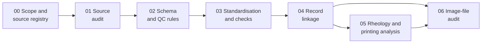

# Open Materials Data Pipeline for Hydrogel Bioink Design

A reproducible data-curation workflow that turns an open hydrogel bioink dataset — raw rheometer exports, a printing image index and 1,031 construct images — into structured, validated and traceable records, and then asks honestly what those records can and cannot support.

**Status:** Phases 00–06 complete. Planned phases 07–12 are described in the [roadmap](docs/roadmap.md).

| | |
|---|---|
| Source | [Zenodo 19602891](https://doi.org/10.5281/zenodo.19602891): phenol-modified alginate (ALG-Ph) and hyaluronic-acid (HA-Ph) inks for 3D bioprinting ([associated publication](https://doi.org/10.1080/17452759.2026.2671497)) |
| Rheology | 92 workbooks (46 viscosity, 46 modulus) → 4,600 measurement points → 39,100 source cells, each traceable to its archive member, worksheet, row and header |
| Images | 1,031 image-index records matched to 1,031 PNG files, with 0 unmatched and 0 unreadable |
| Validation | 839 automated checks across Phases 2–6, with 0 critical failures |
| Tools | Python, pandas, NumPy, openpyxl, Matplotlib, Pillow, Jupyter |

## Phases, notebooks and reports

Each phase takes the documented, validated outputs of the previous one as its controlled input, and records what it read in a run manifest.



| Phase | What it does | Checks passed | Notebook | Report | Details |
|---|---|---:|---|---|---|
| 00 | Defines scope, registers sources, versions and reuse terms | — | [ipynb](notebooks/00_scope_and_source_registry.ipynb) | [view](https://htmlpreview.github.io/?https://github.com/tehsongxuan/hydrogel-bioink-data-curation/blob/main/reports/00_scope_and_source_registry.html) | [phase 00](docs/phases/phase_00.md) |
| 01 | Audits all 92 workbooks and the image index: headers, units, ranges, checksums | — (15 review findings logged) | [ipynb](notebooks/01_zenodo_source_audit.ipynb) | [view](https://htmlpreview.github.io/?https://github.com/tehsongxuan/hydrogel-bioink-data-curation/blob/main/reports/01_zenodo_source_audit.html) | [phase 01](docs/phases/phase_01.md) |
| 02 | Designs a source-grounded schema: 4 entities, 37-field data dictionary, 14 QC rules | 43 | [ipynb](notebooks/02_schema_and_quality_control.ipynb) | [view](https://htmlpreview.github.io/?https://github.com/tehsongxuan/hydrogel-bioink-data-curation/blob/main/reports/02_schema_and_quality_control.html) | [phase 02](docs/phases/phase_02.md) |
| 03 | Standardises values with 13 explicit transformation rules, keeping every original value and unit | 674 | [ipynb](notebooks/03_standardisation_and_quality_checks.ipynb) | [view](https://htmlpreview.github.io/?https://github.com/tehsongxuan/hydrogel-bioink-data-curation/blob/main/reports/03_standardisation_and_quality_checks.html) | [phase 03](docs/phases/phase_03.md) |
| 04 | Tests which records can be linked, separating candidate links from confirmed ones | 26 | [ipynb](notebooks/04_record_linkage_and_analysis_ready_evidence_layer.ipynb) | [view](https://htmlpreview.github.io/?https://github.com/tehsongxuan/hydrogel-bioink-data-curation/blob/main/reports/04_record_linkage_and_analysis_ready_evidence_layer.html) | [phase 04](docs/phases/phase_04.md) |
| 05 | Explores viscosity, G′, G″ and tan δ, and the printing metadata — 25 figures | 86 | [ipynb](notebooks/05_hydrogel_rheology_and_printing_context_analysis.ipynb) | [view](https://htmlpreview.github.io/?https://github.com/tehsongxuan/hydrogel-bioink-data-curation/blob/main/reports/05_hydrogel_rheology_and_printing_context_analysis.html) · [figures](https://htmlpreview.github.io/?https://github.com/tehsongxuan/hydrogel-bioink-data-curation/blob/main/data/processed/hydrogel_rheology_and_printing_context_analysis/phase5_figure_gallery.html) | [phase 05](docs/phases/phase_05.md) |
| 06 | Audits the image files against the index, computes screening descriptors, flags duplicates — 20 figures | 10 | [ipynb](notebooks/06_image_file_audit_optional.ipynb) | [view](https://htmlpreview.github.io/?https://github.com/tehsongxuan/hydrogel-bioink-data-curation/blob/main/reports/06_image_file_audit_optional.html) · [figures](https://htmlpreview.github.io/?https://github.com/tehsongxuan/hydrogel-bioink-data-curation/blob/main/data/processed/image_file_audit/phase6_figure_gallery.html) | [phase 06](docs/phases/phase_06.md) |

The "view" links render the executed notebooks through HTML Preview, a third-party viewer. The same HTML files are stored in [`reports/`](reports/).

## What the curation found

**Data-quality issues caught before analysis**

- **Mixed strain units.** 44 modulus worksheets record strain as a fraction and 2 as a percentage. Without an explicit rule, comparing them would introduce a factor-of-100 error. Only the 100 cells explicitly labelled `%` are converted, and the original values are kept.
- **Unresolved viscosity unit.** The source token `mPas` is kept as-is and not converted to Pa·s, because the export notation is not documented well enough to justify conversion.
- **Modulus tests are amplitude sweeps.** All 46 modulus worksheets show a fixed 1 Hz frequency with varying strain. That is an amplitude sweep, not a frequency sweep, so no linear viscoelastic region is assumed.
- **Out-of-range and nonpositive values.** 20 nonpositive viscosity cells (in 8 worksheets) and shear rates below the publication's stated 0.01 s⁻¹ lower bound are flagged and kept with their source coordinates. Nothing is silently deleted.
- **Missing image annotations.** `completeness_sam` is blank in 943 of 1,031 records and `contain_sps` in 922. Blanks stay "unknown" rather than being read as "no" or "failed".
- **Duplicate images.** Two duplicate or near-duplicate image groups were found. They must be handled before any train/test split to avoid leakage.

**What the data can and cannot support**

- **Measurement points are not samples.** The 4,600 measurement points are repeated observations within 92 worksheets, not 4,600 independent materials. Treating them as independent would inflate any model's apparent performance.
- **No physical-sample links can be confirmed.** Of 62 candidate filename matches between rheology and image records, none can be confirmed as the same physical sample from the source. Candidate links are kept, but labelled as candidates.
- **Not yet ready for supervised prediction.** The data support curation and descriptive analysis. They do not yet support a printability model, because there is no defined, measured target and no confirmed link between formulation, rheology and print outcome. Phase 12 on the [roadmap](docs/roadmap.md) is where that decision is made formally.

## Reproducing the workflow

1. Download `ALG-Ph_HA-Ph_rheology_data.zip`, `image_index.csv` and `images.zip` from the [Zenodo record](https://zenodo.org/records/19602891) into `data/raw/zenodo_19602891/`. The raw archives are not committed (`images.zip` alone is 460 MiB).
2. Create a Python 3.12 environment with pandas, NumPy, openpyxl, Matplotlib, Pillow and Jupyter. The versions each run used are recorded in its run manifest and in the phase docs.
3. Run the notebooks in order, using **Restart Kernel → Run All** for each. Each notebook checks that its inputs are present and consistent before running; Phases 2–4 also verify them by SHA-256 hash against the previous phase's manifest.

Outputs from Phases 5 and 6 are committed under [`data/processed/`](data/processed/). Phases 1–4 regenerate their tables locally and are not committed, because the dataset's redistribution terms are still under review.

## Repository layout

```text
notebooks/        Executable notebooks, one per phase (00–06)
reports/          Executed HTML exports of each notebook
data/processed/   Committed Phase 5 and 6 outputs: figure galleries, figures, CSV tables, run manifests
docs/phases/      Full method, results and output inventory for each phase
docs/background.md   Scientific context, key concepts and scientific boundaries
docs/roadmap.md      Planned phases 07–12 (model audit, Materials Project, Matbench, GEMD, provenance, model readiness)
docs/project_log.md  Earlier checkpoint summaries and publication notes
docs/sources.md      Full source and technical-documentation list
```

## Data source and reuse

Experimental data: Zenodo record [19602891](https://zenodo.org/records/19602891), DOI [10.5281/zenodo.19602891](https://doi.org/10.5281/zenodo.19602891). Associated publication: DOI [10.1080/17452759.2026.2671497](https://doi.org/10.1080/17452759.2026.2671497). Authors' code: [KORINZ/generative-ai-bioprinting-framework](https://github.com/KORINZ/generative-ai-bioprinting-framework).

The figures and tables here are derived from that dataset and credit it as the source. The dataset-specific reuse terms are still being confirmed. The full list of references is in [docs/sources.md](docs/sources.md).

